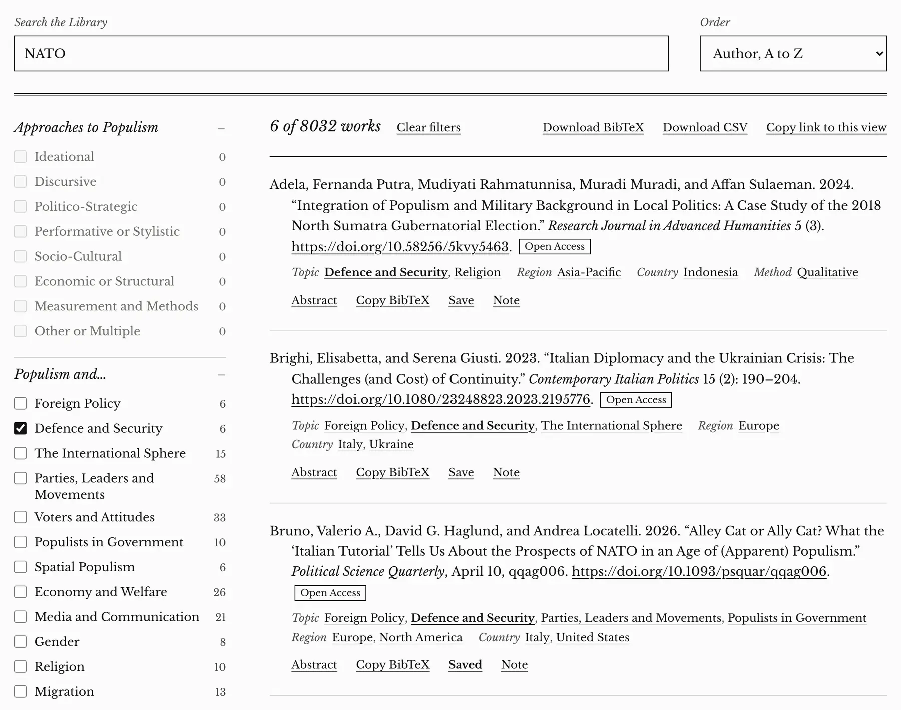
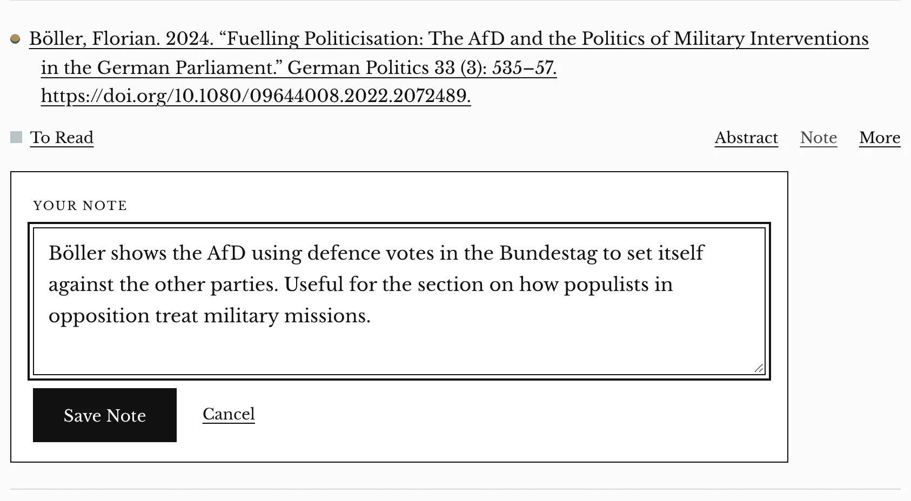
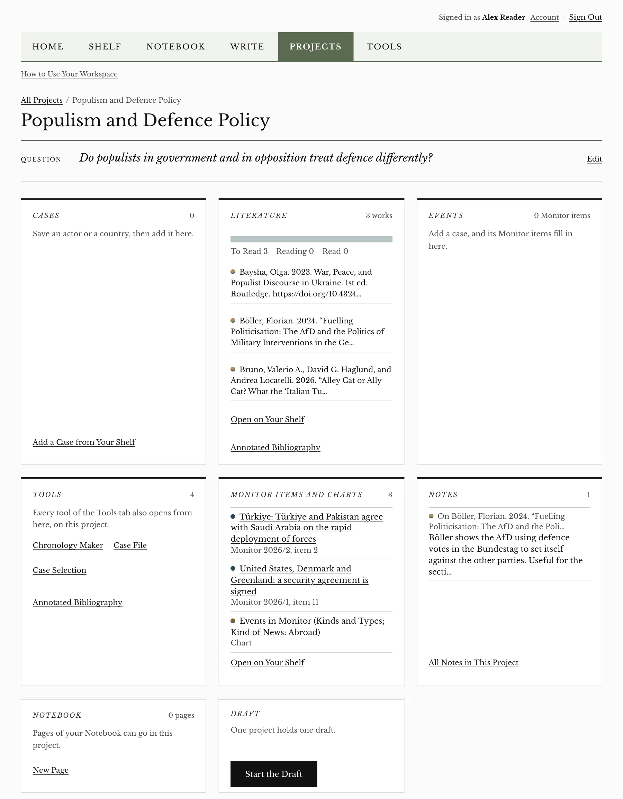
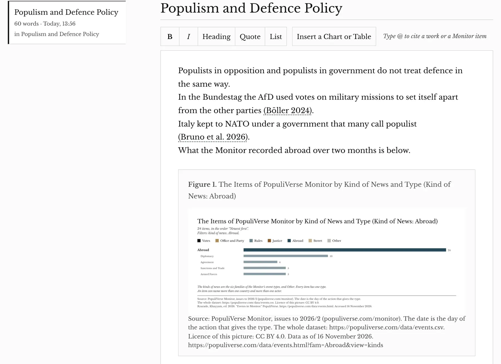
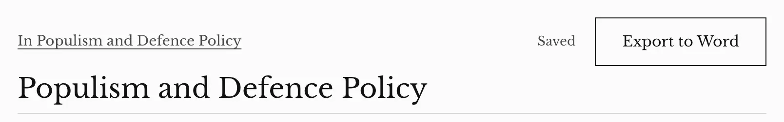

::: {.pv-prose}
The Workspace is your own place on Populi*Verse*.
:::

```{=html}
<figure class="pv-guide-film" id="pv-guide-film">
  <video id="pv-guide-video" width="1120" height="700" muted loop playsinline preload="none"
         poster="guide/flow-still.webp"
         aria-label="The five steps one after another, from saving a work to exporting a draft to Word." hidden></video>
  
  <p class="pv-guide-film-tools" id="pv-guide-tools" hidden><button class="pv-lib-link" type="button" id="pv-guide-pause">Pause the Film</button></p>
</figure>
<script>
(function () {
  var film = document.getElementById("pv-guide-film");
  if (!film) return;
  var video = document.getElementById("pv-guide-video");
  var still = document.getElementById("pv-guide-still");
  // A reader who has asked for less motion keeps the still, and the film is
  // never fetched. The same holds when there is no JavaScript.
  var quiet = window.matchMedia && window.matchMedia("(prefers-reduced-motion: reduce)").matches;
  if (quiet) return;
  video.muted = true;
  video.setAttribute("muted", "");
  video.autoplay = true;
  video.preload = "auto";
  video.src = "guide/flow.mp4";
  video.hidden = false;
  still.hidden = true;
  // The film plays by itself and goes round without end, so the reader gets a
  // button that stops it and starts it again. It shows only once the film runs.
  var tools = document.getElementById("pv-guide-tools");
  var pause = document.getElementById("pv-guide-pause");
  if (pause) {
    pause.addEventListener("click", function () {
      if (video.paused) { video.play(); pause.textContent = "Pause the Film"; }
      else { video.pause(); pause.textContent = "Play the Film"; }
    });
  }
  function back() { video.hidden = true; still.hidden = false; if (tools) tools.hidden = true; }
  var playing = video.play();
  if (playing && playing.then) {
    playing.then(function () { if (tools) tools.hidden = false; }, back);
  } else if (tools) {
    tools.hidden = false;
  }
})();
</script>

<ol class="pv-guide-steps" role="list">
  <li>
    <figure>
      
      <figcaption>Save a work from the Library, a Monitor item or a chart.</figcaption>
    </figure>
  </li>
  <li>
    <figure>
      
      <figcaption>Add a note to it.</figcaption>
    </figure>
  </li>
  <li>
    <figure>
      
      <figcaption>Put it in a project.</figcaption>
    </figure>
  </li>
  <li>
    <figure>
      
      <figcaption>Write a draft, cite with @, insert a chart.</figcaption>
    </figure>
  </li>
  <li>
    <figure>
      
      <figcaption>Export to Word.</figcaption>
    </figure>
  </li>
</ol>
```

::: {.pv-guide-open}
[Open your Workspace](index.qmd)
:::
